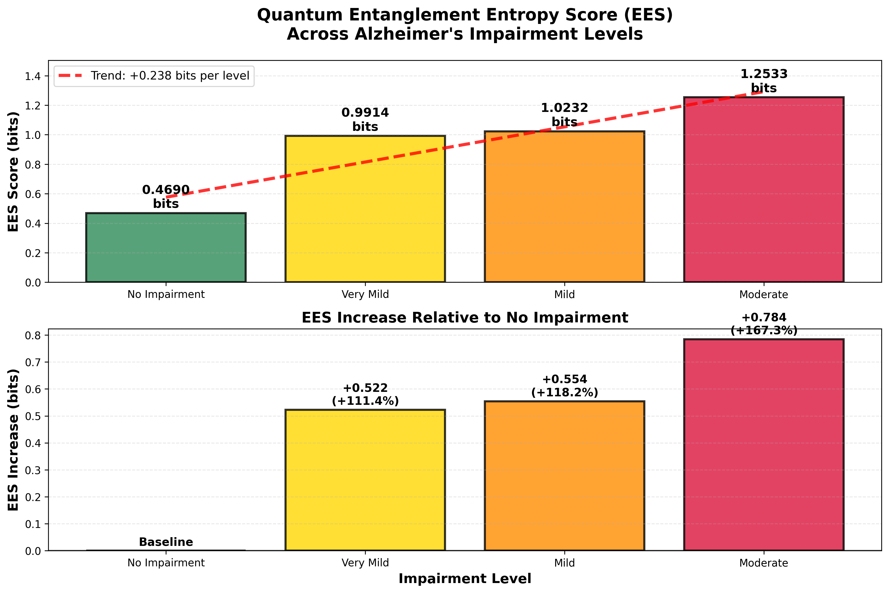

# Qu-Alz

An experimental research system combining brain MRI processing, stage classification, and quantum-derived entropy features.



Qu-Alz began with a research question: could MRI-based stage classification be paired with a quantum-derived signal to support research into earlier Alzheimer's risk assessment?

The resulting prototype connects medical-image processing, machine learning, quantum computation, and a web interface for reviewing the outputs together. It was first developed for SEA Quantathon 2025, where it placed first runner-up. The team later developed the work into a conference paper that was presented at ASEAN IVO Forum 2025.

## Research workflow

```text
Brain MRI
    -> preprocessing and region segmentation
    -> four-stage impairment classification
    -> MRI feature encoding
    -> reduced density matrices
    -> von Neumann entropy
    -> Entanglement Entropy Score
    -> combined research view
```

The system includes:

- PyTorch-based MRI preprocessing and segmentation;
- classification across no, very mild, mild, and moderate impairment classes;
- a quantum path using a `ZZFeatureMap`, density matrices, and von Neumann entropy;
- an Entanglement Entropy Score considered alongside the image-model outputs;
- a Next.js interface for uploading an MRI image and reviewing the generated results;
- notebooks, scripts, trained prototype artifacts, tests, and generated result plots.

## Presented results

The competition presentation framed the system as a combined pipeline rather than a standalone model. The repository retains the outputs used to discuss that pipeline:

- [class-level EES comparison](docs/results/quantum/quantum_ees_class_results.png);
- [EES visualization](docs/results/quantum/quantum_ees_visualization.png);
- [stage-classification confusion matrix](docs/results/segmentation/confusion_matrix.png);
- [sample segmentation and classification outputs](docs/results/segmentation/).

These are experimental prototype results. The project did not conduct clinical evaluation or establish diagnostic performance.

## Run locally

### Research pipeline

```bash
cd quantum-risk
python3 -m venv .venv
source .venv/bin/activate
pip install -r requirements.txt
python test_quantum_ees.py
```

Additional usage notes are available in [`quantum-risk/PIPELINE_USAGE.md`](quantum-risk/PIPELINE_USAGE.md).

### Interface

```bash
cd interface
npm install --legacy-peer-deps
npm run dev
```

The interface is a review surface for the prototype outputs; it is not a clinical application.

## Recognition and presentation

- First runner-up, SEA Quantathon 2025
- Conference paper presented at ASEAN IVO Forum 2025: *Qu-Alz: Quantum-Enhanced Early Prediction of Alzheimer's in Southeast Asia*
- [Project demonstration](https://drive.google.com/file/d/1VnYx8GrsQ_RTE0VKjCUbmoR_bjvI232j/view?usp=sharing)
- [CERN Open Quantum Institute event report](https://open-quantum-institute.cern/asean-quantum-summit-2025-building-regional-collaboration-for-the-future-of-quantum-technology/)
- [Official ASEAN IVO Forum program](https://www.nict.go.jp/en/asean_ivo/2025B_Forum_Program.html?channel=main)
- [Presentation archive](https://naivo.org/index.php/2025forum/presentations/all)

## Team

Qu-Alz was developed by Roi Victor Roberto, Sayed Tahlil Hossain, Dimas Sakti Widyatmaja, and Mutawally Nawwar.

## License

Licensed under the [MIT License](LICENSE).
